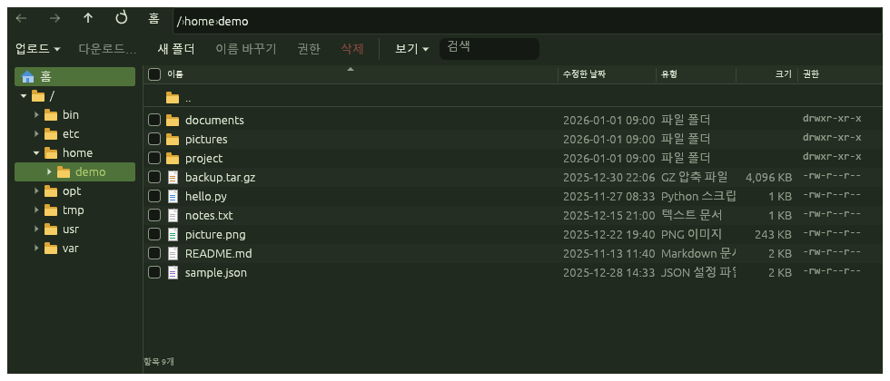

# Ruxt

**보안 기본값을 갖춘 순수 Rust SSH/SFTP 워크스테이션.**

GUI(egui) 기반 다중 탭 SSH 터미널 + 윈도우 탐색기 스타일 SFTP + 포트 포워딩(-L/-R/-D SOCKS5) + 점프 호스트 + X11 포워딩 + 로컬 셸 + 세션 관리자(OpenSSH/PuTTY 가져오기) + 화면 잠금과 암호화된 비밀번호 저장 + 감사 로그를 하나의 바이너리에 담았습니다. UI는 한국어/English.

* 📘 [사용자 가이드](docs/USER_GUIDE.md) · 🛡 [위협 모델](docs/THREAT_MODEL.md) · 📝 [변경 이력](CHANGELOG.md) · 📦 [릴리스](https://github.com/polarbear138/ruxt/releases) · 🌐 [소개 페이지](https://polar-dev-12.github.io/Ruxt/) · 🇬🇧 [English README](README.md) · 🔒 [취약점 신고](SECURITY.md) · 📜 [제3자 구성 요소·라이선스](docs/THIRD_PARTY.md)



## 기능 요약

| 영역 | 내용 |
| --- | --- |
| 터미널 | Alacritty 엔진(`alacritty_terminal`) 기반 VT/xterm-256color 에뮬레이션, 스크롤백 및 스크롤바, **터미널 내 검색(`Ctrl+Shift+F`)**, **URL `Ctrl`+클릭 열기**, **한글/CJK IME 조합 표시**, **상자·블록·점자 문자를 칸에 맞춰 직접 그림**, 마우스 선택/복사/붙여넣기, 마우스 리포팅(SGR), 브래킷 페이스트, 줌, **PC에 설치된 글꼴 선택**(설정 → Terminal → Font, 고정폭 글꼴 우선 표시) |
| 세션 관리 | 그룹별 세션 트리, **최근 연결**, 태그·그룹 검색, 빠른 연결(`user@host:port`), 세션 편집기, 복제/삭제, 시작 명령, keepalive, **점프 호스트(ProxyJump, 최대 4홉, 홉마다 호스트 키·인증 분리)**, **가져오기(OpenSSH `~/.ssh/config`, PuTTY 저장 세션, Ruxt JSON) / 내보내기(비밀 제외)** |
| 인증 | 비밀번호, 공개키 파일(OpenSSH/PKCS8/PuTTY PPK, 암호화 키 지원), SSH 에이전트(Windows OpenSSH 에이전트 named pipe / `SSH_AUTH_SOCK`), keyboard-interactive(OTP/2FA), 자동 순서 시도 |
| SFTP | **윈도우 탐색기 스타일**(뒤로/앞으로/상위, 클릭하면 입력할 수 있는 경로 표시줄, 왼쪽 폴더 트리, 아이콘·이름·수정한 날짜·유형·크기·권한 열 정렬, 행마다 체크박스, Ctrl/Shift 다중 선택, 키보드 탐색: Backspace 상위·Enter 열기·F2 이름 바꾸기·Delete 삭제·F5 새로 고침·Alt+←/→ 이동·Ctrl+A), **로컬 창**(내 PC 폴더를 나란히 보고 드래그로 업로드/다운로드), **잘라내기·복사·붙여넣기와 드래그 이동**(원격 간 복사·일괄 이동), 디렉터리 탐색(대용량 목록 가상화), **터미널 작업 경로 자동 추적(`follow terminal`, OSC 7 / 프롬프트 제목 연동)**, **원격 파일 로컬 편집기 열기 및 저장 시 자동 재업로드**(서버 측 변경 감지, VS Code·Notepad++ 등 설치된 편집기 목록 또는 직접 지정), 업/다운로드(폴더 재귀, 폴더 전체 기준 진행률, 취소, 동시 4개 제한, **임시 파일 → 원자적 교체**로 전송 실패 시 원본 보존), 덮어쓰기 확인, 새 폴더, 이름 변경, chmod, 다중 선택 일괄 삭제, 드래그 앤 드롭 업로드 |
| 명령어 자동 완성 | **화면 잠금 비밀번호가 있을 때** 실행한 명령줄을 암호화해 SQLite(`history.db`)에 저장하고 입력 중 **흐린 글씨 제안 + 후보 목록**(`→` 수락, `Ctrl+↑/↓` 선택, `Esc` 숨김). 같은 서버에서 쓴 명령 우선. 화면에 에코된 글자만 기록하므로 비밀번호 입력은 저장되지 않고, 비밀처럼 보이는 줄·공백으로 시작하는 줄은 건너뜀 |
| 서버 상태 | 상태 표시줄에 **CPU·메모리·첫 디스크**를 흐린 라벨, 36×5 막대, 고정 폭 수치로 표시(60%부터 주황, 85%부터 빨강). 막대를 클릭하면 **서버 정보** 창이 열리고, 부하·스왑·사용자·프로세스는 그 창에 있습니다. 기존 SSH 세션에서 읽기 전용 스크립트를 실행하며(기본 5초), 세션에서 켠 경우에만 동작 |
| 로그 감시 (Tail Viewer) | 터미널에 친 `tail -f`(파일만 대상, 파이프·리디렉션 없는 명령)를 **별도 창**에서 보여 주고 프롬프트는 비워 둠. SFTP 파일 오른쪽 클릭으로도 열림. 일시정지·자동 스크롤·줄바꿈·필터, **키워드 감시**(쉼표로 여러 개, AND/OR, 일치 횟수, 창 깜빡임·강조, 일치한 줄로 이동), 일치한 줄을 `.txt`로 실시간 기록(시각 포함/원문), 메인 창에 붙이기/분리. 설정 → Terminal에서 끔 |
| 터널 | 로컬(-L), 원격(-R), 동적 SOCKS5(-D) 포워딩, 세션별 자동 시작, 실시간 상태 |
| X11 | 원격 X11 → 로컬 X 서버 **포워딩**(가짜 쿠키 ↔ 실제 쿠키 교체, OpenSSH 방식). **기본 비신뢰 모드(`ssh -X`)**: X SECURITY 확장으로 발급한 비신뢰 쿠키로 원격 프로그램을 격리(다른 창 읽기·키 입력 가로채기 불가), 세션별 신뢰 모드(-Y) 선택. **Cygwin/X는 `ruxt.exe` 안에 있음**(VcXsrv·Xming은 지원하지 않음): 무작위 MIT-MAGIC-COOKIE-1 인증 파일로 `-auth` 기동(절대 `-ac` 사용 안 함), 처음 켤 때 `%LOCALAPPDATA%\ruxt\data\xserver`에 풀고 이후 SHA-256으로 확인, 빈 디스플레이 자동 선택. Ruxt를 켤 때는 시작하지 않고(설정 "시작 시"는 기본 꺼짐), X11 세션이 접속하거나 사용자가 직접 켤 때만 시작합니다. 포트를 열기 직전에 Windows 방화벽 인바운드 차단 규칙을 한 번 묻습니다. 거부해도 쿠키만으로 켜지고 상태 메뉴에 경고가 남습니다. 종료 시 정리합니다. 상태 표시줄에 서버 상태가 보이며, 클릭하면 Ruxt가 띄운 서버를 켜거나 끕니다 |
| 테마·언어 | 기본 테마 12개(어두운 6: 말차·퍼플 그린·항구·잿불·잉크·소나무, 밝은 6: 밝음·백자·모래·민트·장미·라벤더). 기본은 말차. **사용자 지정 테마**(편집기에서 UI 색 15가지 + 터미널 색·ANSI 16색을 색상 선택기로 지정, 즉시 미리보기, 이름 저장, `*.ruxt-theme.json` 내보내기/가져오기). UI 언어 한국어/English(번역 누락은 테스트가 잡음). 데스크톱용 컴팩트 Material 3: 면의 밝기로 구역을 나누고, 보조 버튼은 호버 전 고스트, 확인은 pill, 창은 화면 안에 머뭅니다 |
| 그래픽 | 렌더러 OpenGL(glow) / **wgpu(DirectX 12·Vulkan·Metal)**, 하드웨어 가속 선호/필수/끔, VSync (설정 → 그래픽, 재시작 시 적용; `RUXT_RENDERER=wgpu` 환경 변수) |
| 로컬 셸 | ConPTY 기반 PowerShell/pwsh/cmd 탭 |
| 동시 입력 | 모든 SSH 탭에 동시에 키 입력 전송 |
| 에이전트 가드 | Windows 전용, 기본 꺼짐. 창을 스크린샷·녹화·화면 공유에서 숨기고, 다른 프로그램이 주입한 키보드·마우스 입력을 버립니다. 화면 잠금 비밀번호가 있으면 그 입력은 창도 잠급니다 |
| 키 생성 | Ed25519 키쌍 생성(bcrypt-pbkdf 암호화 OpenSSH 포맷) |

## 보안 설계

* **메모리 안전**: 바이너리 전체 `#![forbid(unsafe_code)]`. SSH 프로토콜은 `russh`(순수 Rust), 암호는 RustCrypto/ring.
* **호스트 키 핀닝(TOFU)**: 최초 접속 시 SHA256 지문 + randomart를 보여주고 승인 후에만 저장. 키가 바뀌면 **연결을 차단**하고, 사용자가 명시적으로 확인 체크 후에만 교체(교체 기록에 실패하면 연결하지 않음). `~/.ssh/known_hosts`도 읽기 전용으로 참조. 지문을 확인하는 동안에는 연결 타임아웃이 멈춤.
* **알고리즘 정책**: 기본 *Strict* 프로필은 KEX `mlkem768x25519-sha256`(포스트양자 하이브리드)·`curve25519-sha256`, 호스트키 Ed25519/ECDSA/RSA-SHA2, 암호 `chacha20-poly1305`·AES-GCM, MAC ETM-only. SHA-1, CBC, RSA/SHA-1, DH group1/14-sha1 없음. *Compatible* 프로필은 DH-GEX/group14+(SHA-2)와 CTR 암호를 더하되 SHA-1은 여전히 없음. `ssh-rsa`(SHA-1) 호스트 키 서명이 꼭 필요한 OpenSSH 7.2 이전 서버만 *Legacy* 프로필. DSA·3DES·RC4·CBC는 어느 프로필에도 없음(테스트로 고정).
* **화면 잠금 + 저장된 비밀번호**: 처음 실행 때 비밀번호를 정하면 일정 시간(기본 10분, 10분 단위, 0 = 끔) 사용하지 않을 때 창 전체가 잠기고, 비밀번호가 있으면 잠긴 상태로 시작합니다. 같은 비밀번호로 세션 비밀번호·패스프레이즈를 **Argon2id(64 MiB, 3 pass) + XChaCha20-Poly1305**로 암호화해 저장하며(헤더를 AAD로 묶어 변조 감지), 잠금이 풀려 있을 때만 쓰고 잠기면 메모리에서 지웁니다. 잠금 비밀번호가 없으면 아무것도 저장하지 않습니다. 저장된 비밀은 인증이 끝나는 즉시 세션 태스크에서 소거되며, 교체된 값도 `zeroize`로 지움. 실패할 때마다 다음 확인이 늦어집니다. 세션은 잠금 뒤에서 계속 실행됩니다. (한계: russh에 넘기는 전송용 복사본 하나는 라이브러리가 소유합니다.)
* **터널 기본값**: 로컬/SOCKS 리스너는 루프백에만 바인드(설정에서 명시적으로 해제 가능). SOCKS5는 CONNECT만 허용, 핸드셰이크 10초 제한, 리스너당 동시 연결 256개. 원격 포워딩은 요청한 포트만 수락, 그 외 서버 발신 채널은 거부. 서버가 여는 채널(X11·원격 포워딩)은 세션당 64개로 제한.
* **에이전트/X11 포워딩 기본 OFF**: 켤 때 경고 표시. X11 실제 쿠키는 네트워크로 나가지 않으며, 로컬 쿠키를 찾지 못하면 **인증 없는 접속을 시도하지 않고 채널을 거부**합니다. X11은 기본 **비신뢰 모드**(X SECURITY 확장의 untrusted 쿠키, `ssh -X`와 동일)로 원격 프로그램이 다른 창을 읽거나 키 입력을 가로채지 못하게 하고, 신뢰 모드(-Y)는 세션별로 명시적으로 켭니다. X 서버 클립보드 공유(`-clipboard`)는 기본 꺼짐(설정에서 선택). X 서버 TCP 포트는 Windows 방화벽 차단 규칙으로 LAN에서 닫습니다(루프백은 필터링되지 않아 포워딩은 동작).
* **명령어 기록**: Enter 시점에 화면에 **에코된 글자만** 기록하므로 비밀번호 프롬프트 입력은 저장되지 않음. `password=`·`token=`·`Authorization:`·`*_SECRET=` 패턴과 공백으로 시작하는 줄 제외. `history.db`의 각 줄은 저장된 비밀번호와 같은 저장소에 든 키로 **XChaCha20-Poly1305 암호화**되어 잠금이 풀려 있을 때만 읽히고, 화면 잠금 비밀번호가 없으면 기록하지 않음. 0600, 설정에서 끄기/전체 삭제.
* **클립보드 방어**: OSC 52(원격의 클립보드 쓰기) 기본 차단, 여러 줄 붙여넣기 시 확인 창, 붙여넣기에서 ESC 등 제어문자 제거(클립보드 인젝션 방어).
* **출력 위생**: 창 제목·배너·KI 프롬프트·파일명의 제어문자와 **bidi/보이지 않는 서식 문자(U+202E 등)** 제거. SFTP 원격 파일명은 로컬 경로가 되기 전에 검증: 경로 구분자·`..`·드라이브/스트림 접두사(`C:x`, `a:b`)·예약 장치명(`NUL`, `COM1`)·끝의 점/공백 거부. 디렉터리 심볼릭 링크는 다운로드·삭제 시 절대 따라가지 않음(링크 자체만 삭제). "원격 편집"은 실행 파일·스크립트 확장자를 OS 기본 핸들러로 열지 않음(외부 편집기 지정 시에만).
* **에이전트 가드**(Windows, 기본 꺼짐): 창을 스크린샷·녹화·화면 공유에서 숨기고, 다른 프로그램이 주입한 키보드·마우스 입력을 버립니다. 화면 잠금 비밀번호가 있으면 그 입력은 창도 잠급니다. 입력 훅은 별도 crate에 있어 본체는 `forbid(unsafe_code)`를 유지합니다.
* **감사 로그**: 기본 꺼짐. 켜면 접속/인증(실패 포함)/호스트키/터널/전송/잠금 이벤트를 JSON Lines로 기록(비밀 미포함). 16 MiB 초과 시 1회 회전.
* **파일 권한**: 설정·저장된 비밀번호·known_hosts·키·감사 로그는 생성 시점부터 소유자 전용(0600)으로 만들고, 고유한 임시 이름 + rename으로 원자적 저장. 설정 파일이 깨졌을 때는 덮어쓰지 않고 `config.json.bad-<시각>`으로 보존.
* **빌드 하드닝**: 릴리스에서도 정수 오버플로 검사, LTO, 심볼 제거.

## 빌드

상세 절차(OS별 요구 패키지, 문제 해결, 패키징)는 [BUILD.md](BUILD.md) 를 참고하세요.

```powershell
# Rust 1.95+ (MSVC 또는 GNU 툴체인). Windows에서는 Visual Studio Build Tools(C++)가 필요합니다.
cargo build --release
.\target\release\ruxt.exe
```

리눅스/macOS도 동일하게 `cargo build --release`로 빌드됩니다.

## 파일 위치 (Windows)

| 파일 | 경로 |
| --- | --- |
| 설정·세션 | `%APPDATA%\ruxt\config\config.json` |
| 저장된 비밀번호 | `%APPDATA%\ruxt\config\vault.bin` |
| 호스트 키 | `%APPDATA%\ruxt\config\known_hosts` |
| 감사 로그 | `%LOCALAPPDATA%\ruxt\data\audit.log` |
| 명령어 기록 | `%LOCALAPPDATA%\ruxt\data\history.db` |

## 단축키

| 동작 | 키 |
| --- | --- |
| 복사 | `Ctrl+C`(선택이 있을 때), `Ctrl+Shift+C`, `Ctrl+Insert` |
| 붙여넣기 | `Ctrl+V`, `Ctrl+Shift+V`, `Shift+Insert`, 마우스 오른쪽/가운데 버튼. 줄바꿈이 있으면 확인을 받으며, `Ctrl+Enter`로 바로 붙여넣습니다 |
| 입력란 복사/붙여넣기 | `Ctrl+C` / `Ctrl+V` / `Ctrl+X` (세션 편집기·빠른 연결·SFTP 경로 등 터미널이 아닌 모든 입력란; 터미널 안에서는 선택이 없을 때 `Ctrl+C`가 원격 셸로 전달됨) |
| SFTP 탐색기 | `Backspace` 상위 · `Enter` 열기 · `F2` 이름 바꾸기 · `Delete` 삭제 · `F5` 새로 고침 · `Alt+←/→` 뒤로/앞으로 · `Ctrl+A` 전체 선택 · `Ctrl+X/C/V` 잘라내기/복사/붙여넣기 · 드래그로 이동/업로드/다운로드 |
| 검색 | `Ctrl+Shift+F` (터미널 스크롤백 내 검색, `Enter`/`Shift+Enter`로 이동) |
| 링크 열기 | `Ctrl` + 마우스 왼쪽 클릭 (`http://`, `https://` URL) |
| 스크롤백 | `Shift+PgUp/PgDn/Home/End`, 마우스 휠 |
| 글꼴 크기 | `Ctrl` + 마우스 휠, `Ctrl` + `+` / `-` |
| 재연결 | 세션 종료 후 `Enter` |
| 명령어 자동 완성 | `→` 제안 수락 · `Ctrl+↑/↓` 후보 선택 · `Esc` 숨김 |
| 서버 정보 | 하단 상태 표시줄의 CPU·메모리·디스크 막대(또는 `서버 정보`) 클릭 |

## 테스트

```powershell
cargo test            # 저장된 비밀번호 암복호화·변조 감지, 호스트키 학습/교체, 파일명 검증, SOCKS5 파싱, X11 쿠키 교체,
                      # 붙여넣기 위생, 키/마우스 매핑, OSC 7 분할 수신, ConPTY 로컬 셸 수명주기,
                      # 인프로세스 SSH 서버 E2E: TOFU, 변조 키 차단/명시적 교체, 비밀번호 인증, 셸, -L/-D 포워딩,
                      # 요청하지 않은 forwarded-tcpip 채널 거부
cargo clippy --all-targets -- -D warnings
cargo fmt --check
```

CI(`.github/workflows/ci.yml`)는 Ubuntu·Windows·macOS에서 fmt, clippy, test, `cargo audit`를 실행합니다. 테스트에는 `egui_kittest` 기반 **헤드리스 UI 스모크 테스트**(SFTP 탐색기 선택·정렬·더블클릭·컨텍스트 메뉴·키보드, 세션 편집기 검증, 설정 화면, 번역 누락 검사)가 포함됩니다. `vX.Y.Z` 태그를 푸시하면 릴리스 워크플로가 네 플랫폼 바이너리와 Windows 설치 파일, `SHA256SUMS`를 만듭니다(BUILD.md 참고).

## 진단용 환경변수

| 변수 | 효과 |
| --- | --- |
| `RUXT_LOG=debug` | 로그 상세도 (비밀은 기록되지 않음) |
| `RUXT_THEME=matcha\|purple-green\|harbor\|ember\|ink\|pine\|light\|porcelain\|sand\|mint\|rose\|lavender` | 이번 실행에만 테마 강제 |
| `RUXT_OPEN_LOCAL=1` | 시작 시 로컬 셸 탭 자동 오픈 |

## 설정 항목 (Settings)

| 항목 | 기본값 | 설명 |
| --- | --- | --- |
| External editor | 비어 있음 | SFTP "Edit"가 쓸 편집기. 이 PC에서 찾은 VS Code·Cursor·Notepad++ 등을 고르거나 명령을 직접 넣습니다. 비어 있으면 OS 기본 핸들러를 쓰되 실행 파일·스크립트 확장자는 거부 |
| X server › Clipboard | 꺼짐 | 켜면 원격 X 클라이언트가 로컬 클립보드를 읽고 쓸 수 있음 |
| 세션 › Trusted (-Y) | 꺼짐 | 켜면 원격 X 프로그램이 로컬 디스플레이 전체(다른 창·키 입력)에 접근. 기본은 비신뢰(`ssh -X`) |
| Command completion | 켜짐 | 실행한 명령을 암호화해 `history.db`에 저장하고 입력 중 제안(화면 잠금 비밀번호 필요). 기록 전체 삭제 버튼 |
| Server status | 마스터 켜짐, 5초; 세션별 동의는 꺼짐 | 세션 편집기에서 "서버 상태 모니터링"을 켠 서버에서만 읽기 전용 상태 스크립트를 주기적으로 실행(2~120초) |
| X server › At launch | 꺼짐 | 켜면 Ruxt 시작 시 동봉 X 서버를 콘솔 창 없이 무작위 쿠키로 시작 |
| Clear the clipboard | 0 (끔) | Ruxt가 복사한 내용이 N초 뒤에도 클립보드에 있으면 지움(클립보드 기록·클라우드 동기화 대비) |
| Disconnect all sessions after | 0 (끔) | 유휴 N분 뒤 모든 SSH 세션 끊기 |
| Audit log | 꺼짐 | 접속·인증·전송·잠금 이벤트를 `audit.log`에 기록(설정 → 보안에서 켬) |
| Keep command history / audit log | 90일 / 180일 | 시작 시 오래된 기록 정리(0 = 영구) |
| Windows Error Reporting | 자동 제외 | 시작 시 `ruxt.exe`를 WER 제외 목록에 등록해 메모리 덤프 업로드 방지 |
| Scrollback lines | 10,000 (최대 200,000) | 탭당 히스토리. 10k줄 ≈ 100열 기준 2~5 MB |

설정 변경은 입력이 멈춘 뒤 0.5초 후에 한 번만 디스크에 기록됩니다(종료 시 강제 저장).

## 알려진 범위 제한

* X 서버는 Cygwin/X(`XWin.exe`)를 `ruxt.exe` 안에 **내장**해 처음 쓸 때 `%LOCALAPPDATA%\ruxt\data\xserver`에 풀어 씁니다(빌드 전에 `installer\fetch-xserver.ps1`로 받음). 설정의 `XWin.exe`나 `ruxt.exe` 옆 `xserver\` 폴더가 있으면 그것을 먼저 씁니다. VcXsrv/Xming은 지원하지 않습니다. X 서버는 TCP 6000+n 에 바인드되므로 첫 실행 시 Windows 방화벽 허용 창이 뜰 수 있으며, 외부 접근은 쿠키 인증으로 차단됩니다. RDP/VNC/텔넷/시리얼은 지원하지 않음(텔넷·rlogin은 평문이라 의도적으로 제외).
* 호스트 인증서(CA 서명 호스트키)는 CA 검증 대신 키 자체를 핀닝함.
* Windows에서는 파일 ACL을 직접 설정하지 않고 `%APPDATA%`의 상속 권한(해당 사용자 전용)에 의존합니다.
* 원격 편집 시 로컬 임시 복사본은 `%TEMP%\ruxt-edit-<pid>-<random>\`에 만들어지며 세션 종료·앱 종료 시 삭제되고, 비정상 종료로 남은 하루 이상 된 디렉터리는 다음 시작 때 정리됩니다.

## MobaXterm에서 옮겨 오는 분께

비슷한 기능은 이렇게 찾으면 됩니다.

| MobaXterm | Ruxt |
| --- | --- |
| 세션 목록 | 왼쪽 **세션** 사이드바. 세션 파일은 가져오지 못하므로 OpenSSH `~/.ssh/config`나 PuTTY 저장 세션으로 가져오세요 |
| SSH 브라우저(SFTP 사이드바), 터미널 폴더 따라가기 | 도구 모음 **SFTP**. 보기 → "터미널 작업 폴더 따라가기" |
| MultiExec | 도구 모음 **동시 입력** |
| 내장 X 서버 | 동봉 Cygwin/X. 기본이 **비신뢰 포워딩(`ssh -X`)** 이라 일부 프로그램은 세션 편집기에서 신뢰 모드(-Y)를 켜야 합니다 |
| 터널링 | 도구 모음 **터널**, 세션 편집기의 포워딩 |
| MobaKeyGen | 도구 모음 **키 생성**(Ed25519) |
| 마스터 비밀번호 | **화면 잠금 비밀번호**. 같은 비밀번호로 저장된 비밀번호를 암호화합니다 |

RDP, VNC, 텔넷, 시리얼, 내장 Unix 명령 모음은 없습니다. 대신 Windows, Linux, macOS에서 같은 바이너리로 동작하고, 소스가 공개되어 있습니다.

Ruxt는 MobaXterm과 관계없는 독립 프로젝트입니다. MobaXterm은 Mobatek의 상표입니다.

## 상태

1.0.0은 첫 안정 공개 버전입니다. 핵심(SSH, SFTP, 터널, 저장된 비밀번호, 호스트 키, X11 쿠키)은 인프로세스 SSH 서버에 대한 단위·종단 테스트가 있고, CI는 Windows·Linux·macOS에서 돕니다. 독립 보안 리뷰는 아직 없습니다. 운영 자격증명을 쓰기 전에 [위협 모델](docs/THREAT_MODEL.md)을 읽고, 문제는 [SECURITY.md](SECURITY.md)로 알려 주세요.

## 라이선스

MIT OR Apache-2.0
