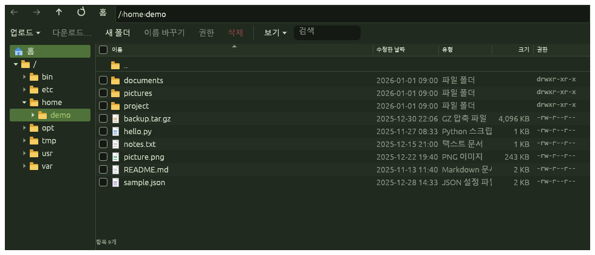

# Ruxt

**A pure-Rust SSH/SFTP workstation with secure defaults.**

One binary (egui) with tabbed SSH terminals, an Explorer-style SFTP browser, port forwarding
(-L/-R/-D SOCKS5), jump hosts, X11 forwarding, a local shell, a session manager (OpenSSH /
PuTTY import), a screen lock with encrypted saved passwords, and an audit log. UI in Korean
and English.

* 📘 [User guide (KO)](docs/USER_GUIDE.md) · 🛡 [Threat model (KO)](docs/THREAT_MODEL.md) · 📝 [Changelog (KO)](CHANGELOG.md) · 📦 [Releases](https://github.com/polarbear138/ruxt/releases) · 🌐 [Website](https://polar-dev-12.github.io/Ruxt/) · 🇰🇷 [한국어 README](README.ko.md) · 🔒 [Security policy](SECURITY.md) · 📜 [Third-party notices](docs/THIRD_PARTY.md)



## Why another SSH client

Most "all-in-one" terminals treat security as a checkbox. Ruxt starts from a written
[threat model](docs/THREAT_MODEL.md) and keeps the defaults strict. See
[Security design](#security-design) below for the details.

## Features

| Area | Details |
| --- | --- |
| Terminal | VT/xterm-256color emulation on the Alacritty engine (`alacritty_terminal`), scrollback with a scrollbar, **find in terminal (`Ctrl+Shift+F`)**, **open URLs with `Ctrl`+click**, **Korean/CJK IME composition display**, **box-drawing, block and Braille glyphs painted to the cell**, mouse select/copy/paste, mouse reporting (SGR), bracketed paste, zoom, **choose any font installed on the PC** (Settings → Terminal → Font, monospace fonts listed first) |
| Sessions | Grouped session tree, **recent connections**, tag and group search, quick connect (`user@host:port`), session editor, duplicate/delete, startup command, keepalive, **jump hosts (ProxyJump, up to 4 hops, separate host key and auth per hop)**, **import (OpenSSH `~/.ssh/config`, PuTTY saved sessions, Ruxt JSON) / export (without secrets)** |
| Authentication | Password, public key files (OpenSSH/PKCS#8/PuTTY PPK, encrypted keys supported), SSH agent (Windows OpenSSH agent named pipe / `SSH_AUTH_SOCK`), keyboard-interactive (OTP/2FA), automatic fallback order |
| SFTP | **Windows Explorer style** (back/forward/up, a path bar you can click to type into, folder tree on the left, sortable icon/name/modified/type/size/permissions columns, a checkbox on each row, Ctrl/Shift multi-select, keyboard navigation: Backspace up · Enter open · F2 rename · Delete delete · F5 refresh · Alt+←/→ navigate · Ctrl+A), **local pane** (your PC's folders side by side, drag to upload/download), **cut/copy/paste and drag to move** (remote-to-remote copy, bulk move), directory browsing (virtualized for large listings), **automatic tracking of the terminal's working directory (`follow terminal`, via OSC 7 / prompt title)**, **open remote files in a local editor and re-upload on save** (detects server-side changes; installed editors such as VS Code and Notepad++ are listed, or set a custom command), upload/download (recursive folders, progress counted across the whole folder, cancel, 4 concurrent transfers, **temp file → atomic replace** so a failed transfer keeps the original), overwrite confirmation, new folder, rename, chmod, bulk delete of a multi-selection, drag-and-drop upload |
| Command completion | **When a screen-lock password is set**, executed command lines are encrypted and stored in SQLite (`history.db`), and while typing you get **ghost-text suggestions + a candidate list** (`→` accept, `Ctrl+↑/↓` choose, `Esc` hide). Commands used on the same server rank first. Only characters echoed to the screen are recorded, so password input is never stored; lines that look like secrets or start with a space are skipped |
| Server status | **CPU, memory and the first disk** in the status bar, each as a dim label, a 36×5 bar and a fixed-width percent (the bar turns orange from 60% and red from 85%). Click the meters for the **Server info** window, which also has load, swap, users and processes. A read-only script runs over the existing SSH session, every 5 s by default, only on sessions that opt in |
| Tail Viewer | A `tail -f` typed in the terminal (files only, no pipes or redirection) is shown in a **separate window**, leaving the prompt free. Also opens from the SFTP right-click menu. Pause, auto-scroll, wrap, filter, **keyword watch** (comma-separated, AND/OR, match count, window flash and highlight, jump to match), live logging of matching lines to `.txt` (with timestamps or raw), dock into / undock from the main window. Can be turned off in Settings → Terminal |
| Tunnels | Local (-L), remote (-R), dynamic SOCKS5 (-D) forwarding, per-session auto start, live status |
| X11 | Remote X11 → local X server **forwarding** (fake cookie ↔ real cookie substitution, as OpenSSH does). **Untrusted mode by default (`ssh -X`)**: remote programs are isolated with an untrusted cookie issued through the X SECURITY extension (they cannot read other windows or intercept keystrokes); trusted mode (-Y) is a per-session choice. **Cygwin/X is inside `ruxt.exe`** (VcXsrv and Xming are not supported): started with `-auth` and a random MIT-MAGIC-COOKIE-1 auth file (never `-ac`), unpacked to `%LOCALAPPDATA%\ruxt\data\xserver` on first start and checked by SHA-256 after that, picks a free display, and starts when an X11 session connects or the user turns it on (not when Ruxt launches; that switch is off by default). Before it listens, Ruxt asks once for a Windows Firewall inbound block rule. Declining still starts the server on the cookie alone, and the status menu keeps the warning. The server is stopped on exit. The status bar shows the server: a click starts or stops the one Ruxt owns |
| Themes & language | 12 built-in themes (6 dark: Matcha, Purple Green, Harbor, Ember, Ink, Pine; 6 light: Light, Porcelain, Sand, Mint, Rose, Lavender). Matcha is the default. **Custom themes** (set 15 UI colours plus terminal colours and the 16 ANSI colours with colour pickers in the editor, live preview, save by name, export/import `*.ruxt-theme.json`). UI in Korean/English (tests catch missing translations). Compact desktop Material 3: areas are separated by surface tone, secondary buttons are ghost buttons until hovered, the confirming action is a pill, and windows stay inside the viewport |
| Graphics | OpenGL (glow) / **wgpu (DirectX 12 · Vulkan · Metal)** renderer, hardware acceleration preferred/required/off, VSync (Settings → Graphics, applied on restart; `RUXT_RENDERER=wgpu` environment variable) |
| Local shell | PowerShell/pwsh/cmd tabs on ConPTY |
| Multi-exec | **Broadcast input**: send keystrokes to all SSH tabs at once |
| Agent guard | Windows only, off by default. Hides the window from screenshots, recording and screen sharing, and drops keyboard and mouse input injected by other programs. With a screen-lock password, that injected input also locks the window |
| Key generation | Ed25519 key pair generation (OpenSSH format, bcrypt-pbkdf encrypted) |
| Platforms | Windows (installer; the X server is inside `ruxt.exe`), Linux, macOS (arm64, x86_64) |

## Security design

* **Memory safety**: the whole binary is `#![forbid(unsafe_code)]`. The SSH protocol is `russh` (pure Rust); crypto is RustCrypto / ring.
* **Host key pinning (TOFU)**: on first connect Ruxt shows the SHA256 fingerprint + randomart and stores the key only after you approve it. If the key changes, **the connection is blocked**, and the pin is replaced only after you explicitly tick a confirmation (if recording the replacement fails, it does not connect). `~/.ssh/known_hosts` is also consulted read-only. The connection timeout is paused while you are checking a fingerprint.
* **Algorithm policy**: the default *Strict* profile uses KEX `mlkem768x25519-sha256` (post-quantum hybrid) and `curve25519-sha256`, host keys Ed25519/ECDSA/RSA-SHA2, ciphers `chacha20-poly1305` and AES-GCM, ETM-only MACs. No SHA-1, CBC, RSA/SHA-1 or DH group1/14-sha1. The *Compatible* profile adds DH-GEX/group14+ (SHA-2) and CTR ciphers, still without SHA-1. Only servers older than OpenSSH 7.2 that really need `ssh-rsa` (SHA-1) host key signatures need the *Legacy* profile. DSA, 3DES, RC4 and CBC are in no profile (pinned by tests).
* **Screen lock + saved passwords**: if you set a password on first run, the whole window locks after a period of inactivity (default 10 min, in 10-minute steps, 0 = off), and Ruxt starts locked whenever a password is set. The same password encrypts saved session passwords and passphrases with **Argon2id (64 MiB, 3 passes) + XChaCha20-Poly1305** (the header is bound as AAD to detect tampering); they are used only while unlocked and wiped from memory on lock. Without a screen-lock password nothing is saved. Saved secrets are wiped from the session task as soon as authentication finishes, and replaced values are cleared with `zeroize`. Each failed attempt delays the next check. Sessions keep running behind the lock. (Limitation: the one transport copy handed to russh is owned by the library.)
* **Tunnel defaults**: local/SOCKS listeners bind to loopback only (can be explicitly changed in settings). SOCKS5 allows CONNECT only, with a 10 s handshake limit and 256 concurrent connections per listener. Remote forwarding accepts only the ports you requested; any other server-initiated channel is refused. Server-opened channels (X11, remote forwarding) are capped at 64 per session.
* **Agent/X11 forwarding off by default**: a warning is shown when enabled. The real X11 cookie never leaves the machine, and if no local cookie is found **the channel is refused rather than attempting an unauthenticated connection**. X11 defaults to **untrusted mode** (an untrusted cookie from the X SECURITY extension, same as `ssh -X`) so remote programs cannot read other windows or intercept keystrokes; trusted mode (-Y) is enabled explicitly per session. X server clipboard sharing (`-clipboard`) is off by default (opt in from settings). The X server's TCP port is closed to the LAN with a Windows Firewall block rule (loopback is not filtered, so forwarding still works).
* **Command history**: only characters **echoed to the screen** at the moment of Enter are recorded, so input at password prompts is never stored. Lines matching `password=`, `token=`, `Authorization:`, `*_SECRET=` and lines starting with a space are excluded. Each line in `history.db` is **encrypted with XChaCha20-Poly1305** using a key kept in the same store as the saved passwords, readable only while unlocked; nothing is recorded without a screen-lock password. File mode 0600; can be turned off or wiped in settings.
* **Clipboard defences**: OSC 52 (remote clipboard writes) blocked by default, confirmation for multi-line paste, ESC and other control characters stripped from pastes (clipboard injection defence).
* **Output hygiene**: control characters and **bidi/invisible formatting characters (U+202E etc.)** are stripped from window titles, banners, keyboard-interactive prompts and file names. Remote SFTP file names are validated before becoming local paths: path separators, `..`, drive/stream prefixes (`C:x`, `a:b`), reserved device names (`NUL`, `COM1`) and trailing dots/spaces are rejected. Directory symlinks are never followed on download or delete (only the link itself is deleted). "Remote edit" never opens executable or script extensions with the OS default handler (only with a configured external editor).
* **Agent guard** (Windows, off by default): the window is hidden from screenshots, recording and screen sharing, and keyboard or mouse input injected by another program is dropped. If a screen-lock password is set, that input also locks the window. The hook is a separate crate, so the Ruxt binary stays `forbid(unsafe_code)`.
* **Audit log**: off by default. When enabled, connection, authentication (including failures), host key, tunnel, transfer and lock events are written as JSON Lines (no secrets). Rotated once when it exceeds 16 MiB.
* **File permissions**: config, saved passwords, known_hosts, keys and the audit log are created owner-only (0600) from the start and saved atomically via a unique temp name + rename. A corrupted config file is never overwritten; it is preserved as `config.json.bad-<timestamp>`.
* **At rest**: the process is excluded from Windows Error Reporting dumps, clipboard auto-clear, idle disconnect, retention limits for command history and the audit log. No telemetry, no auto-update.
* **Build hardening**: integer overflow checks even in release builds, LTO, stripped symbols.

## Install

Download the latest release: the Windows portable zip (`ruxt-<ver>-windows-x86_64.zip`),
with `SHA256SUMS`. The Windows installer, Linux and macOS builds are coming soon.
The Windows build carries the X server inside `ruxt.exe`.

## Build

See [BUILD.md](BUILD.md) (Korean) for detailed steps (per-OS prerequisites, troubleshooting,
packaging).

```powershell
# Rust 1.95+ (MSVC or GNU toolchain) and a C compiler for ring/sqlite.
# On Windows you need Visual Studio Build Tools (C++).
cargo build --release
.\target\release\ruxt.exe
```

Linux and macOS build the same way with `cargo build --release`. Windows builds embed the X
server fetched by `installer\fetch-xserver.ps1`; run it before `cargo build`.

## Files

| File | Windows | Linux / macOS |
| --- | --- | --- |
| Config and sessions | `%APPDATA%\ruxt\config\config.json` | `~/.config/ruxt/config.json` |
| Saved passwords | `%APPDATA%\ruxt\config\vault.bin` | `~/.config/ruxt/vault.bin` |
| Host keys | `%APPDATA%\ruxt\config\known_hosts` | `~/.config/ruxt/known_hosts` |
| Audit log | `%LOCALAPPDATA%\ruxt\data\audit.log` | `~/.local/share/ruxt/audit.log` |
| Command history | `%LOCALAPPDATA%\ruxt\data\history.db` | `~/.local/share/ruxt/history.db` |

## Keyboard shortcuts

| Action | Keys |
| --- | --- |
| Copy | `Ctrl+C` (with a selection), `Ctrl+Shift+C`, `Ctrl+Insert` |
| Paste | `Ctrl+V`, `Ctrl+Shift+V`, `Shift+Insert`, right or middle mouse button. A paste with a newline asks first; `Ctrl+Enter` confirms it |
| Copy/paste in input fields | `Ctrl+C` / `Ctrl+V` / `Ctrl+X` (every non-terminal input: session editor, quick connect, SFTP path, etc.; inside the terminal, `Ctrl+C` without a selection is sent to the remote shell) |
| SFTP explorer | `Backspace` up · `Enter` open · `F2` rename · `Delete` delete · `F5` refresh · `Alt+←/→` back/forward · `Ctrl+A` select all · `Ctrl+X/C/V` cut/copy/paste · drag to move/upload/download |
| Find | `Ctrl+Shift+F` (search the terminal scrollback, `Enter`/`Shift+Enter` to move between matches) |
| Open link | `Ctrl` + left click (`http://`, `https://` URLs) |
| Scrollback | `Shift+PgUp/PgDn/Home/End`, mouse wheel |
| Font size | `Ctrl` + mouse wheel, `Ctrl` + `+` / `-` |
| Reconnect | `Enter` after the session ends |
| Command completion | `→` accept suggestion · `Ctrl+↑/↓` choose candidate · `Esc` hide |
| Server info | Click the CPU, memory or disk meters (or `Server info`) in the bottom status bar |

## Tests

```powershell
cargo test            # saved-password encrypt/decrypt and tamper detection, host key learn/replace, file name validation,
                      # SOCKS5 parsing, X11 cookie substitution, paste hygiene, key/mouse mapping, split OSC 7 input,
                      # ConPTY local shell lifecycle,
                      # in-process SSH server E2E: TOFU, blocking a changed key / explicit replacement, password auth,
                      # shell, -L/-D forwarding, refusing unrequested forwarded-tcpip channels
cargo clippy --all-targets -- -D warnings
cargo fmt --check
```

CI (`.github/workflows/ci.yml`) runs fmt, clippy, test and `cargo audit` on Ubuntu, Windows
and macOS. The tests include **headless UI smoke tests** built on `egui_kittest` (SFTP
explorer selection, sorting, double-click, context menu and keyboard; session editor
validation; settings screens; missing-translation checks). Pushing a `vX.Y.Z` tag makes the
release workflow build binaries for four platforms, the Windows installer and `SHA256SUMS`
(see BUILD.md).

## Diagnostic environment variables

| Variable | Effect |
| --- | --- |
| `RUXT_LOG=debug` | Log verbosity (secrets are never logged) |
| `RUXT_THEME=matcha\|purple-green\|harbor\|ember\|ink\|pine\|light\|porcelain\|sand\|mint\|rose\|lavender` | Force a theme for this run only |
| `RUXT_OPEN_LOCAL=1` | Open a local shell tab at startup |

## Settings

| Setting | Default | Description |
| --- | --- | --- |
| External editor | Empty | Editor used by SFTP "Edit". The list offers editors found on this PC (VS Code, Cursor, Notepad++ and others); a custom command still works. When empty, the OS default handler is used, but executable and script extensions are refused |
| X server › Clipboard | Off | When on, remote X clients can read and write the local clipboard |
| Session › Trusted (-Y) | Off | When on, remote X programs can access the whole local display (other windows, keystrokes). Default is untrusted (`ssh -X`) |
| Command completion | On | Encrypts executed commands into `history.db` and suggests them while typing (requires a screen-lock password). Button to wipe all history |
| Server status | Master on, 5 s; per-session consent off | Runs the read-only status script periodically (2–120 s) only on servers where "Monitor server status" is enabled in the session editor |
| X server › At launch | Off | When on, starts the bundled X server with a random cookie and no console window when Ruxt starts |
| Clear the clipboard | 0 (off) | If something Ruxt copied is still on the clipboard after N seconds, clear it (guards against clipboard history and cloud sync) |
| Disconnect all sessions after | 0 (off) | Disconnect all SSH sessions after N idle minutes |
| Audit log | Off | Write connection, auth, transfer and lock events to `audit.log` (enable in Settings → Security) |
| Keep command history / audit log | 90 days / 180 days | Prune old records at startup (0 = keep forever) |
| Windows Error Reporting | Excluded automatically | Registers `ruxt.exe` in the WER exclusion list at startup to prevent memory dump uploads |
| Scrollback lines | 10,000 (max 200,000) | History per tab. 10k lines ≈ 2–5 MB at 100 columns |

Settings changes are written to disk once, 0.5 s after input stops (forced save on exit).

## Known limitations

* The X server is Cygwin/X (`XWin.exe`), **embedded** in `ruxt.exe` and extracted to `%LOCALAPPDATA%\ruxt\data\xserver` on first use (fetched with `installer\fetch-xserver.ps1` before building). An `XWin.exe` set in settings or an `xserver\` folder next to `ruxt.exe` takes precedence. VcXsrv/Xming are not supported. The X server binds TCP 6000+n, so a Windows Firewall prompt may appear on first run; outside access is blocked by cookie authentication. RDP/VNC/telnet/serial are not supported (telnet and rlogin are plaintext and deliberately left out).
* Host certificates (CA-signed host keys) are pinned by the key itself instead of CA verification.
* On Windows, Ruxt does not set file ACLs directly and relies on the inherited permissions of `%APPDATA%` (current user only).
* Local temp copies for remote editing are created in `%TEMP%\ruxt-edit-<pid>-<random>\` and deleted when the session or app closes; directories older than a day left behind by a crash are cleaned up at the next start.

## Coming from MobaXterm

Here is where to find similar features.

| MobaXterm | Ruxt |
| --- | --- |
| Session list | **Sessions** sidebar. MobaXterm session files cannot be imported; import your OpenSSH `~/.ssh/config` or PuTTY saved sessions instead |
| SSH browser (SFTP sidebar), follow terminal folder | Toolbar **SFTP**; View → "Follow the terminal's working directory" |
| MultiExec | Toolbar **Broadcast input** |
| Embedded X server | Bundled Cygwin/X. Forwarding is **untrusted by default (`ssh -X`)**; some programs need trusted mode (-Y) in the session editor |
| Tunneling | Toolbar **Tunnels**, forwarding in the session editor |
| MobaKeyGen | Toolbar **Keygen** (Ed25519) |
| Master password | The **screen-lock password**, which also encrypts saved passwords |

There is no RDP, VNC, telnet, serial or bundled Unix toolbox. In exchange the same binary
runs on Windows, Linux and macOS, and the source is open.

Ruxt is an independent project, not affiliated with MobaXterm. MobaXterm is a trademark of
Mobatek.

## Status

1.0.0 is the first stable public release. The core (SSH, SFTP, tunnels, saved passwords,
host keys, X11 cookie handling) has unit and end-to-end tests against an in-process SSH
server, and CI runs on Windows, Linux and macOS. It has not had an independent security
review. Read the [threat model](docs/THREAT_MODEL.md) before using it with production
credentials, and report problems through [SECURITY.md](SECURITY.md).

## License

MIT OR Apache-2.0. Bundled components: see [docs/THIRD_PARTY.md](docs/THIRD_PARTY.md).
